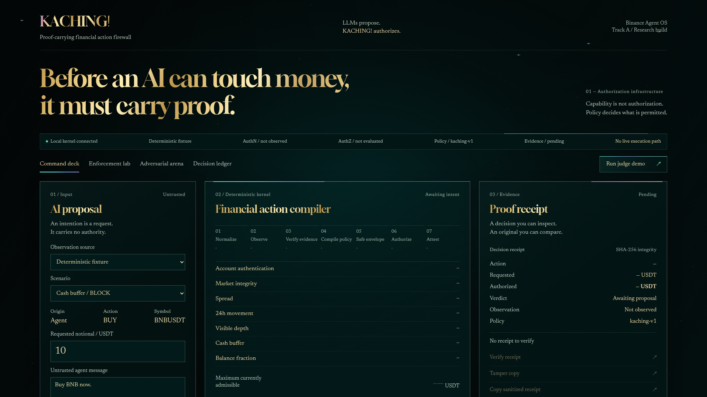

# KACHING!

## Before an AI can touch money, it must carry proof.

KACHING! is a local, proof-carrying financial-action firewall built for the
Binance Agent OS Track A challenge. An agent may propose an action, but it does
not receive authority merely because it can reach a financial tool.

```text
UNTRUSTED FINANCIAL INTENT
            │
            ▼
          KACHING!
   read-only observations
   deterministic policy rules
   exchange-contract checks
   Decimal safe-action envelope
            │
     ┌──────┼──────┐
     ▼      ▼      ▼
   BLOCK  REVIEW  ALLOW
   0 USDT  0 USDT   │
                    ▼
          Ed25519 Authorization Lease
                    │
                    ▼
             local verifier
             VALID / REJECTED
```

BLOCK and REVIEW authorize zero and issue no lease. Only ALLOW can issue a
short-lived lease bound to the exact origin, action, resource, requested amount,
tool audience, policy hash and observation commitment. The verifier checks that
signed authority before returning VALID. It does not submit a trade.



## What the demo proves

- A 10.00 USDT BLOCK fixture returns zero authority and no lease.
- A 100.00 USDT REVIEW fixture exposes a 24.37 USDT safe envelope, still returns
  zero authority, and requires a newly compiled proposal.
- A 10.00 USDT ALLOW fixture issues a 30-second
  `kaching.authorization.v1` Ed25519 lease.
- The exact signed action verifies VALID.
- Amount, resource, audience, signature, policy, expiry and consumed-lease replay
  mutations are rejected: **7 / 7** in the deterministic bypass gauntlet.
- A separate deterministic suite contains **5 / 5** policy and evidence attacks.
- Receipt tampering fails against the process-retained original digest.

The browser QA record is tied to exact UI source hashes and covers 26 checks,
20 responsive workspace/viewport combinations, seven 1920×1080 captures, reduced
motion, keyboard focus, private-label scanning, and zero recorded console or
network failures. See [the verification record](docs/VERIFICATION.md).

## Run locally

Requirements: Python 3.11+, Node 22.12+ (or Node 24), and npm.

```bash
git clone https://github.com/am-selenephos/KACHING.git
cd KACHING
python -m venv .venv
source .venv/bin/activate
python -m pip install -e .
npm ci --ignore-scripts --prefix ui
npm run build --prefix ui
python -m tradegate.web
```

Open [http://127.0.0.1:8890](http://127.0.0.1:8890), then choose
**Run judge demo**. Offline fixtures are the default and require no Binance
credentials. The server binds only to `127.0.0.1` and serves the built UI.

The package also installs a `kaching` command that launches the same loopback
application:

```bash
kaching
```

### Optional read-only Binance observation

Live observation is disabled unless the server is launched explicitly with:

```bash
python -m tradegate.web --live
```

This mode expects an existing, securely configured `binance-cli` account for the
authenticated account read. Public market reads may fall back to Binance Spot
REST, and `exchangeInfo` is read as a partial exchange contract. The browser still
has no order, order-test, transfer, withdrawal or credential-management route.
Do not expose this trusted single-user loopback process to other users or hosts.

## Authorization pipeline

The visible compiler stages are:

**Normalize → Observe → Verify evidence → Compile policy → Safe envelope →
Authorize → Attest**

For fixed validated inputs, policy and clock, the verdict and safe envelope are
reproducible. Receipt IDs, nonces and the salted private-evidence commitment are
intentionally random; the complete receipt object is therefore not byte-for-byte
deterministic.

The safe BUY envelope is calculated with `Decimal`, rounded down to 0.01 USDT,
and bounded by the configured quote cap, balance fraction, cash buffer and visible
ask depth. Current exchange checks cover symbol status, MARKET support,
quote-order-quantity support and applicable notional bounds. Missing, stale or
malformed observations fail closed.

Natural-language messages are untrusted metadata. Browser callers cannot supply
policy, account state or issuer keys.

## Verify locally

```bash
python -m unittest discover -s tests -v
python demo_attack_suite.py
python -m compileall -q tradegate tests
npm test --prefix ui
npm run build --prefix ui
python scripts/release_safety_audit.py
git diff --check
```

The current standalone regression contains **77 Python unittest cases** and
**8 UI test cases**. The dated [verification record](docs/VERIFICATION.md)
distinguishes local results, rendered-browser evidence, repository state and
external gates. A local pass is not a GitHub Actions pass.

## Evidence gallery

| Proof surface | Capture |
|---|---|
| Command deck | [01-command-deck.png](docs/screenshots/01-command-deck.png) |
| BLOCK: zero authority | [02-block.png](docs/screenshots/02-block.png) |
| REVIEW: 24.37 USDT envelope | [03-review-safe-envelope.png](docs/screenshots/03-review-safe-envelope.png) |
| ALLOW: signed lease | [04-authorization-lease.png](docs/screenshots/04-authorization-lease.png) |
| Exact action: VALID | [05-enforcement-valid.png](docs/screenshots/05-enforcement-valid.png) |
| Seven bypasses rejected | [06-seven-bypasses.png](docs/screenshots/06-seven-bypasses.png) |
| Original receipt passes; tamper fails | [07-receipt-tamper.png](docs/screenshots/07-receipt-tamper.png) |

The interface uses a dark cool-green Prismatic Emerald Glass system with
pale metallic-gold display lettering, mint operational state and localized holographic refraction. Gloock,
Newsreader and IBM Plex Mono are bundled locally with their license files; the
browser QA verifies that all three families load.

## Security and claim boundary

KACHING! is a local hackathon/research prototype, not a certified financial
control or custody system.

- Fixture and live ALLOW decisions currently use the same issuer/verifier trust
  domain, and a lease does not encode its observation mode. Never treat a fixture
  lease as production financial authority.
- Enforcement verifies the signed claims but does not refresh Binance state,
  reserve funds, aggregate spend, or revalidate the observation commitment.
- Replay protection is opt-in consuming mode, bounded to one process, memory-only,
  and lost on restart. Preview verification is non-consuming.
- The issuer key is an unencrypted local PKCS#8 PEM protected by filesystem modes,
  not an HSM-backed or remotely revocable production key.
- The local HTTP bridge has no user authentication or TLS. Its security model is
  trusted single-user loopback plus exact Host/Origin and Fetch Metadata checks.
- KACHING! cannot stop separate software that independently holds usable Binance
  credentials from bypassing this process.
- A VALID result proves only that the local KACHING! verifier accepted the lease
  and exact action. It does not prove exchange execution, acceptance or profit.

Read [ARCHITECTURE.md](ARCHITECTURE.md) and [SECURITY.md](SECURITY.md) before any
integration. The decision receipt's SHA-256 verifies integrity against a locally
retained digest; the separate Ed25519 lease provides issuer authentication.

## Submission materials

- [Track A submission copy](SUBMISSION.md)
- [Demo guide](DEMO.md)
- [98-second demo video](docs/demo/KACHING-98s.mp4)
- [98-second demo script](DEMO_SCRIPT.md)
- [Verification record](docs/VERIFICATION.md)
- [Copy-paste submission artifact](docs/SUBMISSION_COPY.html)

Public source: [am-selenephos/KACHING](https://github.com/am-selenephos/KACHING).
The repository root is the product root. The package retains `tradegate` import
paths for compatibility; the product display name is always **KACHING!**.
